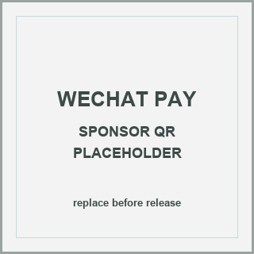
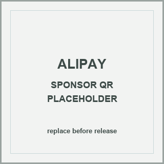

# littrace

<p align="center">
  <a href="README.md">English</a> · <b>简体中文</b>
</p>

<p align="center">
  <a href="LICENSE"></a>
  
  <a href="https://github.com/kingside33/littrace/actions/workflows/ci.yml"></a>
  <a href="https://github.com/sponsors/kingside33"></a>
</p>

**本地优先的文献研究脉络整理与证据溯源工作台。**

littrace 把 Zotero 文献库（含条目所附 PDF）和 Obsidian 笔记接进同一个工作台：为正文片段、图表和公式建立索引，梳理文献之间的引用、继承与改进关系，并让问答的每条结论都能回到原文页码。后端用 FastAPI + SQLite，前端是原生 JavaScript，不需要 Node 构建；索引、检索和离线导出不需要云端账号，但带引用问答与关系核验需要先配置云端模型。PDF、笔记和 Zotero 库都留在原位。问答走检索增强（RAG）：答案由检索到的片段组装，不靠模型记忆。

> **状态：私有仓，尚未发布。** 目前没有已发布的版本、发布 tag、发布日期和下载链接；唯一受支持的是 `main` 顶端。Web 界面当前为中文。

CI 徽章指向 `.github/workflows/ci.yml`；仓库转公开并实际运行工作流后才会显示状态。

## 能做什么

- **证据检索。** 一个搜索框覆盖正文片段、图注和公式；可按研究方向、课题、年份、Collection、标签、章节和单篇文献筛选。结果给出命中片段和页码，不拿生成摘要冒充证据。
- **带引用问答。** 问题最多拆成 4 种表达，重排约 40 个片段，最终最多保留 16 条证据。答案按结论逐条生成：只有引文、论文归属、页码、指标、单位、基线和实验条件都通过本地核验与独立云端复核，结论才进入答案；没通过的写成缺口，不润色成通顺段落。可并排比较 2 至 4 篇论文。这条链路需要先在设置页配置兼容 OpenAI 的云端模型；未启用云端调用时，界面会提示问答尚未配置，不会改用本地模型生成答案。
- **研究谱系与脉络图。** 引用事实和方法关系分开记录。`继承 / 改进 / 融合 / 迁移 / 对比 / 相似` 等方法关系必须有双方原文的逐字证据并通过独立复核，才算已核；只有摘要支持的关系保持“摘要支持”等级，不会悄悄升级。关系核验同样需要云端模型：未启用云端调用时，关系分析返回 `awaiting_configuration`，不会开始。图谱使用内置的中文方法大类，面向机器人／路径规划文献（采样、图搜索、元启发式、控制、感知等），它只是展示归类，不能配置；提供研究链和时间演化两种视图。引用次数不算方法继承。
- **离线导出。** `python kb.py export offline` 生成自包含的 `_index/exports/evolution.html`，以及机器入口 `current.json` 和 `llms.txt`。离线页与在线图谱使用同一份数据和同一套筛选，不依赖服务进程；新导出按版本发布，构建失败不会覆盖上一版。
- **研究调度台。** 全文理解与笔记维护、谱系补全、关系核验、完整增量更新和向量索引都在一个地方启动、停止和续跑。任务按真实阶段事件显示进度、在途文献或关系对、已核与证据不足的区分，以及模型调用、Token 和费用；停止保留已完成单元，续跑直接复用。

littrace 不写入 Zotero，不改 PDF，也不覆盖 Obsidian 里的自由正文——它只更新自己管理的区块。云端模型调用和 OpenAlex／Crossref 查询对同步、索引、检索和离线导出是可选项；带引用问答和方法关系核验不是纯本地功能，两者都需要先配置云端模型，未配置时界面会明确提示。不使用这两项的纯本地运行不需要云端账号。

## 安装与快速开始

### 环境要求

Python 3.10 及以上。Windows x64 是主要且唯一已验证的平台；macOS 与 Linux 尚未验证。支持矩阵的唯一出处是 [`docs/support-matrix.json`](docs/support-matrix.json)，其中定义 Python 版本、平台、Zotero 版本与本地模型组合，并记录状态与已测试版本；目前 Zotero 和 Ollama 均为 `unverified`，`tested_versions` 为空，[首次运行](#首次运行)里的模型 tag 只是默认值，不是已验证的组合。

### 从源码安装

```bash
git clone https://github.com/kingside33/littrace.git
cd littrace
python -m venv .venv

# Windows（PowerShell）
.venv\Scripts\Activate.ps1
# Windows（cmd）
.venv\Scripts\activate.bat
# macOS / Linux
source .venv/bin/activate

pip install -e ".[dev]"
python kb.py serve
```

仓库在预发布阶段仍为私有，`git clone` 只对已获授权的账号可用。目前没有公开下载或发布包；没有权限时 clone 会返回 404 或要求登录。

浏览器打开 <http://127.0.0.1:8765>。界面当前为中文。`kb.py` 是唯一命令入口，不另设 console script。

### 指向你的文献库

默认 `KB_BASE` 是仓库根目录，`KB_DATA_DIR` 是 `<KB_BASE>/_index`。文献库与代码不在一起时，用环境变量或子命令前的 `--base` / `--data-dir` 指定：

```bash
python kb.py --base ~/research/library --data-dir ~/research/library/_index serve
```

| 变量 | 用途 | 默认值 |
|---|---|---|
| `KB_BASE` | 文献库根目录：`_知识库`、`_index` 与 `map_pdfs` 扫描的 PDF 树 | 仓库根目录 |
| `KB_DATA_DIR` | 运行数据：SQLite、索引、缓存、导出、备份 | `<KB_BASE>/_index` |
| `KB_ZOTERO_DIR` | Zotero 数据目录，含 `zotero.sqlite` 与 `storage/` | 空 |
| `KB_BLAS_THREADS` | 本地服务的 BLAS/OMP 线程数 | `1` |

`KB_ZOTERO_DIR` 指向的库只做只读快照，littrace 不写回 Zotero。

PDF 作为 Zotero 条目的附件进入流程。要新增文献，先在 Zotero 中添加条目并附上 PDF，把 `KB_ZOTERO_DIR` 指向 Zotero 数据目录，再运行 `update`；该命令读取条目元数据和附件路径，不导入独立的 PDF 目录。`map_pdfs` 数据工具（`python kb.py data tool map_pdfs`）会扫描 `KB_BASE`，把磁盘上的 PDF 匹配到索引中已有的文献记录；匹配不到的文件写入 `orphan_pdfs.json`，不会自动生成文献。生成的文献卡片位于 `_知识库/10_文献/<方向>/`，应用托管的图表和公式图片位于 `_知识库/_attachments/`。

方向表、课题名、Zotero 集合归类规则与向量检索指令默认都是中性占位符，仓库不携带个人文献库结构；默认方向表有 11 项（`00`–`09` 与 `90`），全部是占位符。需要按机器覆盖时使用 `KB_DIRECTIONS`（JSON 数组，元素为 `[编号, 文件夹名, 显示名, 说明]`）、`KB_COLLECTION_RULES` / `KB_DISK_RULES`（JSON 数组，元素为 `[路径前缀, [方向编号]]`）、`KB_DIR_COLLECTION_PREFIX`（JSON 对象）、`KB_PROJECT`、`KB_PROJECT_STAGES`（JSON 对象）、`KB_EVOLUTION_DIRECTIONS`（JSON 数组）以及 `KB_QUERY_INSTRUCTION` / `KB_FIG_QUERY_INSTRUCTION` / `KB_FORMULA_QUERY_INSTRUCTION`。`KB_LIBRARY_TITLE` 与 `KB_LIBRARY_TOPIC` 可覆盖生成索引的标题与主题行。具体形状见 `kbapp/core/config.py` 与 `kbapp/core/markers.py`。`kbapp/research/method_taxonomy.py` 的内置方法大类，以及 `kbapp/library/cards.py` 的题名关键词回退（`KEYWORD_RULES`）都是固定的，按机器人／路径规划词汇编写，没有环境变量可覆盖；其他领域可以设置上面的方向变量，但只靠关键词得到的方向仍可能需要手工纠正。

### 首次运行

```bash
python kb.py update --local-only   # 同步元数据，解析并 OCR 已批准全文，切块，建索引
python kb.py index                 # 只补齐缺失的向量
python kb.py search "..." --bm25-only --json
python kb.py export offline
```

本地模型通过 Ollama 调用，默认地址 `http://127.0.0.1:11434`。Ollama 是外部前置条件，不是 Python 依赖；首次 `update` 或 `index` 前要先安装并启动 Ollama，再把代码默认的三个 tag 拉到本地：

```bash
ollama pull qwen3-embedding:8b
ollama pull glm-ocr:latest
ollama pull gemma4:e4b
```

这些是代码默认值（`qwen3-embedding:8b`，1,024 维；`glm-ocr:latest`；`gemma4:e4b` 用于本地关系核验），不是已验证的模型组合。OCR 地址可用 `GLM_OCR_URL` 改写，本地核验模型可在设置页修改。云端复核与问答对同步、索引、检索和离线导出是可选项；带引用问答和关系核验需要先在设置页填写兼容 OpenAI 的地址和密钥。Windows 下密钥由 DPAPI 保护。新增全文必须在审批页批准后才会获取。

## 架构

`kb.py` 是唯一命令入口。`kbapp` 是单体应用，按职责分为八个模块，依赖单向流动：

| 模块 | 职责 |
|---|---|
| `core` | 路径、I/O、指纹、锁、文本与资源组装 |
| `storage` | SQLite 结构、数据库迁移与持久事件 |
| `integrations` | Zotero、Ollama、云端模型、OpenAlex 与 OCR 适配 |
| `library` | 文献元数据、附件、解析、识别与笔记来源 |
| `search` | 来源索引、向量缓存、关键词与混合检索 |
| `research` | 证据核验、精读、问答与研究关系 |
| `workflows` | 任务协调、更新、发布、迁移与运维 |
| `web` | 应用工厂与按功能分组的 HTTP 路由 |

依赖从 HTTP/CLI 入口流向 `workflows` → `research` → `search` → `library` → `core`。`AppContext` 提供路径、存储、检索和任务协调器，`create_app(context)` 组装 FastAPI 应用；导入模块不会打开数据库、启动线程或调用模型。前端由 Python 直接提供资源，运行时不需要 Node 构建。

| `_index` 路径 | 内容 |
|---|---|
| `state` | SQLite 数据库、配置、迁移日志与校验清单 |
| `indexes` | 按版本发布的来源、关键词与向量索引 |
| `cache` | OCR、向量、元数据、提取与核验缓存 |
| `files` | 由应用管理的全文 |
| `runtime` | 锁、运行队列、日志与隔离验证资料 |
| `exports` | 离线页面、机器入口、审计与评测报告 |
| `backups` | 仅 SQLite 数据库备份（`workbench.sqlite3` 与 `manifest.json`）；不含 PDF、Zotero 原件和 Obsidian 笔记 |
| `archive` | 旧索引、实验产物与参考源码 |

SQLite 的 `active_version` 是活动索引的唯一权威。普通检索只读已发布版本；重建失败不会替换上一可用版本。数据库结构版本与数据目录布局版本分别维护。

## 开发

```bash
python -m pytest -m "not network and not model"
ruff check .
python kb.py doctor architecture
```

Python 检查使用 `pytest`；离线套件就是 CI 使用的 `not network and not model` 过滤结果。`pyproject.toml` 只注册了 `network` 与 `model` 两个 marker，没有 `live` marker，所以 `-m "not live"` 不会排除任何测试。CI 配置为 Ubuntu 上的 Python 3.10／3.13 和 Windows 上的 3.13，夜间任务另测 3.14。`tests/` 下另有若干 `.cjs` 浏览器逻辑检查，用 Node 自带测试运行器执行；Node 不是运行依赖。`doctor architecture` 检查模块依赖方向与导入副作用。

## 支持

### 数据安全优先

littrace 的升级会在用户唯一的文献库上执行数据库结构和数据目录迁移。迁移属于支持范围，不是实现细节。

安全升级的完整路径是四条命令；最后一条只在需要回退时运行：

```bash
python kb.py backup --label before-upgrade
python kb.py data plan
python kb.py data migrate
python kb.py data rollback   # 只在需要回退时运行
```

- `backup` 使用 SQLite backup API 生成一致副本，执行 `PRAGMA integrity_check` 并记录关键表计数（`kbapp/workflows/backup.py:32-52`）。
- `plan` 严格只读，返回路径和逐文件 SHA-256 校验清单，不移动任何文件（`kbapp/workflows/data.py:61-78`）。
- `migrate` 在第一次移动前写迁移日志，逐文件核对校验清单，中断后可续跑；目标冲突时停止，不覆盖（`kbapp/workflows/data.py:131-205`）。
- `rollback` 反向调整文件位置和路径字段，同时保留业务记录（`kbapp/workflows/data.py:207-236`）。
- 数据库结构迁移与布局迁移分开。结构迁移在事务中执行，应用 DDL 前先保存 `pre-schema-<version>.sqlite3` 备份（`kbapp/storage/schema.py:88-101`）；新版本无法打开数据库时，恢复这份备份。

这些是承诺，不是建议：

- 无法在不丢数据的前提下完成的升级，按高优先级 bug 处理，不当成配置问题。
- 迁移不会静默覆盖已存在的目标；遇到冲突就停止并报告。
- 目录布局变化不会触发全量 OCR 或全量向量重算。
- 升级前必须备份。PDF、Zotero 原件和 Obsidian 笔记不在 SQLite 数据库里，数据库备份不包含它们，请用各自的工具另行备份。

迁移时关闭服务并确认没有活动任务。`migrate` 会检查任务、研究运行和参考文献队列，有活动任务就拒绝执行（`kbapp/workflows/data.py:52-59`）。

### 版本支持

littrace 目前处于预发布阶段：仓库私有，没有任何已发布构建。唯一受支持的是 `main` 顶端，更早的提交不支持；没有发布分支、LTS 或 backport，修复只落在 `main`。

| 渠道 | 状态 |
|---|---|
| `main` 顶端 | 支持 |
| 更早的提交 | 不支持 |
| 发布版本 | 尚无 |

首次公开发布后，支持范围收窄为只支持最新发布版，更早版本一律不支持。届时才会给出带真实版本号和日期的版本表；现在不提前公布。

### 兼容性

Python 版本、平台、Zotero 版本和本地模型组合的状态只在 [`docs/support-matrix.json`](docs/support-matrix.json) 定义。README 与 `SECURITY.md` 只引用这个权威矩阵，不另外维护一套；如果别处的摘要与它不一致，以 JSON 为准。状态不等于支持承诺：该文件目前把 Zotero 和 Ollama 标为 `unverified`，两者的 `tested_versions` 都为空。

### 响应预期

支持由单人尽力提供。目标是在 7 天内给出首次回复；没有 SLA，没有保证修复时间，也没有漏洞赏金。安全问题请走 [`SECURITY.md`](SECURITY.md) 的私密报告入口，不要开公开 issue。报 bug 时附上 `python kb.py doctor status` 的完整输出，并先抹掉密钥和个人路径。针对 `main` 顶端、可复现的报告处理最快。

### 不在支持范围

- 自行修改过的构建，包括打过补丁的依赖或 fork 的 `kbapp`。
- 旧提交和预发布快照。
- 只有扫描器报告、无法在干净检出上复现的问题。
- 本地模型或代理配置错误：Ollama 地址不对、模型 tag 未下载、代理拦截请求。
- Zotero 自身的问题，或 littrace 只读访问的 Zotero 库里的问题。
- 功能请求。欢迎提出，但不构成支持承诺。

### 托管服务与机构授权

如果未来上线托管服务，它只运行最新版，与社区支持策略一致。机构双许可客户可能要求固定版本，届时应另立“机构支持”条款，而不是悄悄改变社区支持策略。

未来 Zotero 插件发布时，会另立“插件 × Zotero 版本”矩阵；当前矩阵只覆盖桌面工作台。

## Roadmap

**路线图只表示方向，不构成承诺。条目可能调整顺序、变更或取消。**

| 阶段 | 方向 | 层次 |
|---|---|---|
| **现在（Now）** | 稳定开源核心与文档。现有开源功能保持完整，不被移入付费层。 | 开源 |
| **下一步（Next）** | Zotero 插件。形态与范围待定；先在公开仓库做可行性验证，不在这里列功能清单。 | 开源 |
| **以后（Later）** | 商业层。付费形态与付费点未定；原则见[商业模式](#商业模式)。 | 商业 |

这张表刻意不写日期：一旦写日期，方向就变成了承诺。

## 商业模式

littrace 是本地优先的文献工具。核心以 AGPL-3.0-only 开源，可选的商业层用于支持它的维护。

### 付费形态

付费功能集尚未确定。本节写的是原则，不是价格表。

1. 未来 Zotero 插件中的高级功能——范围待公布。
2. 托管服务订阅——范围待公布。
3. 机构双许可——范围待公布。

### 原则

- **（a）现有开源功能不设付费墙。** 现有开源功能不会被移入付费层；付费能力必须是增量。
- **（b）本地优先能力尽量免费可用。** 云侧、协作和规模化能力是天然的付费面。
- **（c）边界清晰。** 商业代码与 AGPL-3.0-only 核心保持清晰的仓库与进程边界；商业许可不减少任何人的 AGPL-3.0-only 权利。
- **（d）条款公开。** 价格、条款、包含与不包含的内容公开发布并版本化。
- **（e）贡献者。** 贡献者的署名方式与贡献的使用范围写在贡献条款里。贡献按 DCO 签署接受；涉及商业版本使用的单独条款见 [`CONTRIBUTING.md`](CONTRIBUTING.md)。

### 开源与商业边界

| 组件 | 仓库 | 许可证 |
|---|---|---|
| 开源核心 | 公开 | AGPL-3.0-only |
| 未来 Zotero 插件的高级功能 | 私有 | 商业许可 |
| 托管服务 | 私有 | SaaS 条款 |

这张表只划仓库与许可证，不列功能。一个组件只有以声明的许可证公开源码，才算从私有变为公开。

### 发布与更新

每个对外发布的版本都对应公开仓库中同一 tag 的源码与 changelog。tag 是发布内容的唯一真相；不存在只留在私有分支里的发布源码。

### 隐私与遥测

**默认不采集遥测。** littrace 不含分析 SDK、使用打点或后台版本检查。它会为你在用的功能发起网络请求：Zotero 在本机读取；OpenAlex／Crossref 元数据、云端模型复核和 PDF 下载只在相应功能启用或被触发时发生。任何请求都不携带使用统计。若未来加入遥测，会默认关闭、在本文件说明并提供关闭方式。

## 赞助

littrace 由一个人维护。赞助用于维护：依赖升级、CI 分钟数、文档，以及把迁移做安全所需的时间。

| 渠道 | 链接 |
|---|---|
| GitHub Sponsors | <https://github.com/sponsors/kingside33> |
| 爱发电 | <https://afdian.com/a/littrace> |
| Open Collective | <https://opencollective.com/littrace> |
| 企业赞助 | 开 issue 联系：<https://github.com/kingside33/littrace/issues> |

中文用户也可以用微信或支付宝赞赏码：

<p>
  
  
</p>

图片是占位，本仓库不存放真实收款信息。赞赏为自愿赠与，不开发票，也不解锁任何功能。GitHub Sponsors、爱发电、Open Collective 目前都是占位链接，账号开通后替换；企业赞助通过 issue 联系，不公开邮箱。

企业赞助权益仅限 logo、README 致谢和 issue 优先处理；不与付费功能、私有 roadmap 或商业许可绑定。

**赞助用于维护，不解锁付费功能；付费功能另行销售。**

每季度在 README 或 Discussions 发一次赞助用途短更新（依赖升级、CI 分钟数、文档），金额不大也会更新。

## 许可证

littrace 以 GNU Affero 通用公共许可证第 3 版（仅限该版）发布。SPDX 标识：`AGPL-3.0-only`。见 [LICENSE](LICENSE)。

本地使用、自行修改、在实验室内部部署都不受限制。义务针对分发，以及把修改版作为网络服务提供给他人：这些用户必须能取得对应源码。

你处理的论文、PDF、笔记和导出产物仍归你所有；许可证不延伸到研究数据。

如另行提供商业许可，只覆盖本项目自有代码。第三方依赖仍按各自许可证执行。例如 PyMuPDF 采用 AGPL-3.0-only 或 Artifex 商业许可，其条款不因 littrace 的许可证而改变。依赖清单与许可证见 [`THIRD_PARTY_NOTICES.md`](THIRD_PARTY_NOTICES.md)，分发或托管前请核对。

项目名称与标识的规则见 [`TRADEMARKS.md`](TRADEMARKS.md)。

### 贡献

欢迎提交 bug 报告和补丁。请先读 [`CONTRIBUTING.md`](CONTRIBUTING.md) 和 [`CODE_OF_CONDUCT.md`](CODE_OF_CONDUCT.md)：你的贡献仍然属于你，按 AGPL-3.0-only 授权给所有人，同时额外授权维护者把这份贡献用于商业版本；本项目不设 CLA，每个 commit 都需要 DCO `Signed-off-by`。

---

如果 littrace 帮你省了时间，欢迎给仓库点个 star。
